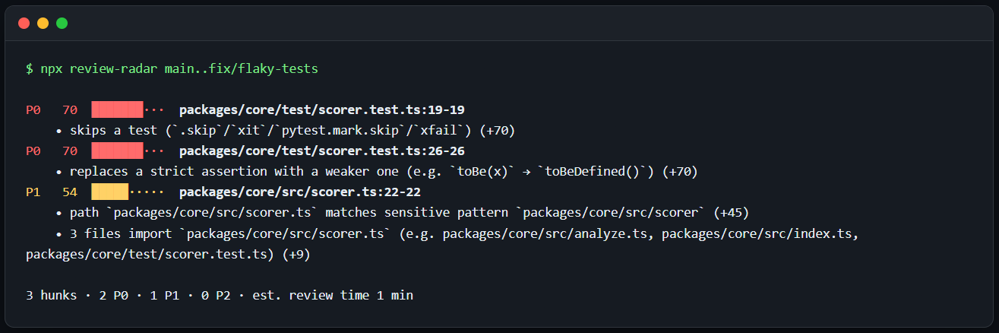
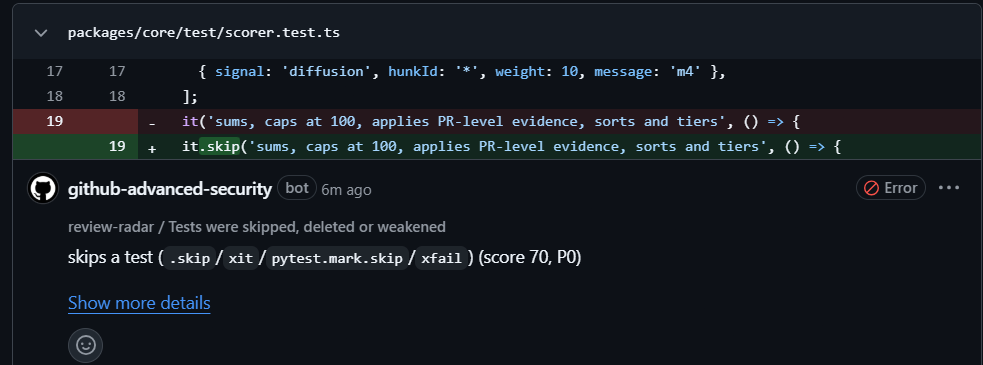

# 📡 Review Radar

**Which lines of this AI-written PR do I actually need to read?**

Review Radar scores every hunk of a pull request from 0–100, sorts it into **P0 must-read / P1 should-read / P2 skim**, and tells you *why* in plain sentences. It's deterministic, runs offline, and needs no API key or LLM.



AI agents now write PRs faster than humans can review them. Teams either merge code nobody really read or let PRs pile up. Review Radar doesn't add another wall of AI comments. It **removes reading**: it points you at the hunks that can hurt you and lets you skim the rest with a clear conscience.

## Install

### GitHub Action

```yaml
# .github/workflows/review-radar.yml
on: pull_request
permissions: { contents: read, pull-requests: write, security-events: write }
jobs:
  radar:
    runs-on: ubuntu-latest
    steps:
      - uses: actions/checkout@v7
        with: { fetch-depth: 0 }
      - uses: 44dummies/review-radar@v1
```

You get **one** PR comment (edited on every push, never re-posted), a job summary, inline annotations on the riskiest lines, and results in GitHub code scanning (free on public repos).


The same findings show up inline in **Files changed** through GitHub code scanning (P0 as warnings, P1 as notes, so they never turn your PR red unless you set `fail-on`):



### CLI

```bash
npx review-radar                 # current branch vs main
npx review-radar main...HEAD     # PR-style range (from the merge-base)
npx review-radar --format md     # markdown | json | sarif | terminal
npx review-radar --fail-on P0    # exit 1 if anything must be read
```

## What it looks at

| Signal | Example evidence |
|---|---|
| **sensitive-path** | path `src/auth/session.ts` matches sensitive pattern `auth` · adds code matching `child_process` |
| **blast-radius** | 14 files import `src/core.ts` (e.g. src/api.ts, src/cli.ts, …) |
| **untested-change** | 32 changed lines in `pay.ts`; no test file imports it or mentions `charge` |
| **test-gaming** | skips a test (`.skip`/`xit`/`pytest.mark.skip`) · replaces a strict assertion with a weaker one |
| **dependency-change** | adds dependency `left-pad@^1.3.0` · bumps `react` 18 → 19 (major) |
| **churn** | file changed 7 times in the last 90 days |
| **size / diffusion** | hunk changes 64 lines · PR touches 23 files across 9 directories |
| **external-sarif** | Semgrep js.sqli: SQL injection |

The import graph and test detection understand **TypeScript, JavaScript and Python** (via tree-sitter). Every other language still gets path, diff, git and SARIF signals.

Default weights and how to tune them: see [Signals and weights](#signals-and-weights) below.

## Bring your scanners

Review Radar merges in any SARIF 2.1.0 file, from tools like Semgrep, CodeQL, [noskip](https://github.com/DariusHQ/noskip) and [open-code-review](https://github.com/alibaba/open-code-review). A finding that lands inside a changed hunk raises that hunk's score, so your existing tools decide *what's* wrong and Review Radar decides *where to look first*.

```yaml
- uses: 44dummies/review-radar@v1
  with:
    sarif: semgrep.sarif,noskip.sarif
    lcov: coverage/lcov.info      # optional: real line coverage for untested-change
    fail-on: P0                   # optional: block merges until P0s are reviewed
```

## AI-authorship badge

When commits carry agent trailers (`Co-Authored-By: Claude`, Copilot, Cursor, Codex, Devin…), bot authors, or "Generated with" footers, the comment is labelled **🤖 Likely AI-authored**. Contribution guides ask for this disclosure, and it's often skipped.

## Why not just an AI reviewer?

AI reviewers add text you have to read. Review Radar subtracts it, and every score comes with evidence you can check in seconds. **Use both:** point your AI reviewer at the P0s.

| | AI review bots | Review Radar |
|---|---|---|
| Output | More comments | A ranked reading list |
| Reproducible | No (sampling) | Yes (same diff → same scores) |
| Needs API key / sends code out | Usually | Never |
| Cost per PR | Tokens | Free |

## Configure

Add a `.reviewradar.yml` to your repo root. Every key is optional:

```yaml
weights:
  testGaming: 90          # make test tampering an instant P0
tiers: { p0: 70, p1: 40 }
sensitivePaths: ["ledger", "kyc"]
ignore: ["**/generated/**", "**/*.snap"]
```

### Signals and weights

A hunk's score is `min(100, sum of its evidence weights)`. Tiers: **P0 ≥ 70**, **P1 ≥ 40**, **P2** below. Override any weight under `weights:`.

<details>
<summary>Show all signals and default weights</summary>

| Signal | Weight keys (default) | Fires when |
|---|---|---|
| sensitive-path | `sensitivePath` (45), `sensitiveCode` (35) | path matches `sensitivePaths` (auth, session, token, jwt, oauth, passw, secret, credential, crypto, encrypt, permission, rbac, acl, payment, billing, checkout, stripe, mpesa, invoice, migrations, `.env`, `Dockerfile`, `.github/workflows`), or added lines match `sensitiveCode` (child_process, exec, eval, `new Function`, dangerouslySetInnerHTML, subprocess, os.system, pickle.loads, yaml.load, bcrypt, jwt.sign/verify, createHash/createCipher, `innerHTML =`, disabled TLS verification) |
| blast-radius | `blastRadiusPerImporter` (3), `blastRadiusMax` (30) | other files import the changed file (TS/JS/Python import graph, cached per commit) |
| untested-change | `untestedChange` (25) | no test imports the file or mentions the changed symbols; with `lcov`, none of the changed lines are covered |
| test-gaming | `testGaming` (70) | in test files: test deleted, `.skip`/`xit`/`pytest.mark.skip`/`xfail` added, `.only`/`fit` added, net assertions removed, strict matcher weakened (`toBe(x)` → `toBeDefined()`) |
| dependency-change | `dependencyManifest` (30), `dependencyMajor` (+20), `dependencyLockfile` (10) | new dependency, major bump, or lockfile change |
| churn | `churnPerChange` (2), `churnMin` (3), `churnMax` (20) | file changed often in the last `churnDays` (90); off on shallow clones |
| size | `sizePer10Lines` (2), `sizeMin` (20 lines), `sizeMax` (20) | large hunk |
| diffusion | `diffusion` (10) | PR touches ≥ `diffusion.files` (10) files or ≥ `diffusion.dirs` (5) directories |
| external-sarif | `sarifError` (40), `sarifWarning` (20), `sarifNote` (5) | a `sarif` finding lands inside a changed hunk |

Default `ignore`: `dist/**`, `build/**`, `vendor/**`, `*.min.js` at any depth. Binary files are listed as skipped.

</details>

## How it works

```
git diff ──▶ hunks ──▶ signals (9, independent) ──▶ score = min(100, Σ weights) ──▶ terminal · md · json · sarif
repo     ──▶ import graph (tree-sitter) · git history
*.sarif  ──▶ external findings
```

Each signal is one small file in [`packages/core/src/signals`](packages/core/src/signals). Adding one (Go imports, Terraform IAM, Rust `unsafe`…) is a great first PR.

## Roadmap

- **v1.1**: MCP server + Claude Code / Codex skill, so agents can see where reviewers will look *before* opening the PR
- **v1.2**: optional LLM explainer for P0 hunks
- More languages for the import graph (community signals welcome)

## License

MIT
